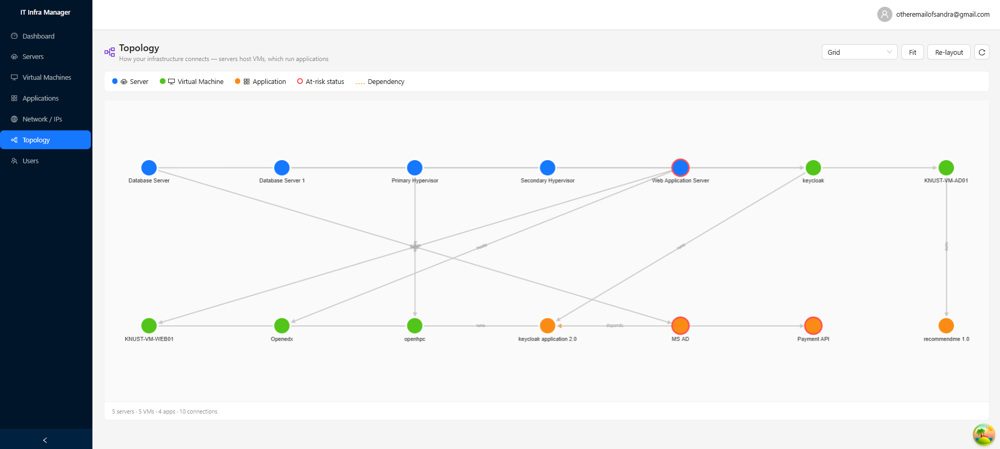
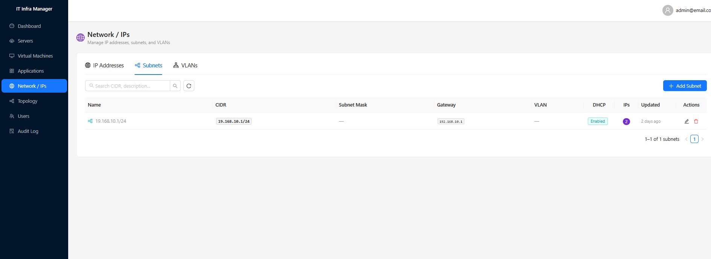
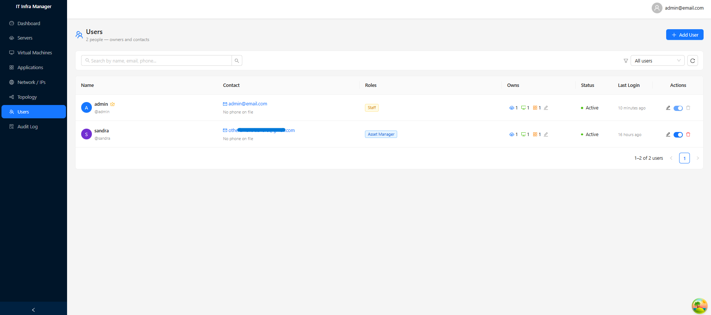

# IT Infrastructure Management System

A web application for tracking an organisation's servers, virtual machines, applications and IP addresses, and the people responsible for them. It shows how everything connects and records every change. The idea is similar to NetBox.

## Features

- **Dashboard**: totals, status charts, fleet capacity, a "needs attention" panel and recent activity.
- **Servers**: status tracking (active, inactive, unracked, maintenance, decommissioned), hardware specs, OS, front and rear photos, owner, IP addresses and services.
- **Virtual machines**: host server, cluster, OS, resources, owner, IP addresses and services.
- **Applications**: deployed on a VM or a server, with an owner and dependencies on other applications.
- **Network**: IP addresses, subnets (mask, gateway, DNS, DHCP) and VLANs. Masks, gateways and addresses are checked against their subnet.
- **Topology**: an interactive graph of servers, VMs and applications and how they depend on each other.
- **Users**: a contact directory showing who owns what and how to reach them. Admins can assign assets to people.
- **Audit log**: who changed what and when, with field-level before and after values (admins only).
- **Authentication and roles**: JWT sign-in. Ordinary users edit only their own profile, staff manage users, and only superusers grant admin rights.

### Available in the API, not yet in the interface

These backend features work and are covered by tests, but have no screens yet:

- Whole-fleet status counts: `GET /api/v1/servers/status-counts/` (also for VMs and applications)
- Subnet utilisation and next free IP: `GET /api/v1/subnets/{id}/next-free/`
- Warranty and end-of-life dates on servers, with an expiring-soon list in `GET /api/v1/dashboard/stats/`
- Reachability checks (ping and TCP): `POST /api/v1/servers/{id}/check/`, or for all hosts:
  `docker compose exec backend python manage.py check_reachability --once`

## Screenshots

**Sign in**


**Dashboard**: totals, status charts, capacity, attention items and recent activity


**Topology**: how servers, VMs and applications connect



<table>
  <tr>
    <td width="50%"><b>Servers</b><br></td>
    <td width="50%"><b>Virtual machines</b><br></td>
  </tr>
  <tr>
    <td><b>Applications</b><br></td>
    <td><b>Network / IP addresses</b><br></td>
  </tr>
  <tr>
    <td><b>Subnets</b><br></td>
    <td><b>Users and owners</b><br></td>
  </tr>
  <tr>
    <td><b>Audit log</b><br></td>
    <td></td>
  </tr>
</table>

## Tech Stack

| Layer | Technology |
|---|---|
| Backend | Python 3.12, Django 5, Django REST Framework |
| Auth | JWT (SimpleJWT) |
| Database | PostgreSQL 15 |
| Frontend | React 18, TypeScript, Vite, Ant Design |
| Data fetching | TanStack Query |
| Visualisation | Recharts, Cytoscape.js |
| Infrastructure | Docker, Docker Compose, Nginx |
| CI | GitHub Actions |

## Getting Started

You need [Docker Desktop](https://www.docker.com/products/docker-desktop/) installed and running.

```bash
# 1. Create your environment file
cp .env.example .env
```

Open `.env` and set at least:
- `DJANGO_SECRET_KEY`: a long random value. Generate one with `python -c "import secrets; print(secrets.token_urlsafe(50))"`
- `DB_PASSWORD`: a password of your choice for the local database

```bash
# 2. Build and start everything
docker compose up --build -d

# 3. Create the database tables
docker compose exec backend python manage.py migrate

# 4. Create an admin account (asks for email, username and password)
docker compose exec backend python manage.py createsuperuser
```

Then open:

| Service | URL |
|---|---|
| App | http://localhost:3001 |
| API | http://localhost:8000/api/v1/ |
| API docs (Swagger) | http://localhost:8000/api/docs/ |
| Django admin | http://localhost:8000/admin/ |

Sign in with the **email** and password you created in step 4.

### Ports

| Port | Used by |
|---|---|
| 3001 | Frontend. 3001 rather than 3000 to avoid clashing with tools like Grafana |
| 8000 | Backend API |
| 80 | Nginx, serving the app and API from one address |
| 5433 | PostgreSQL, for database tools on this machine only (set `DB_HOST_PORT` in `.env` to change it) |

## Running the Tests

```bash
docker compose exec backend python manage.py test tests
docker compose exec frontend npx tsc --noEmit
```

The same checks, plus a production build of the frontend, run on every push through GitHub Actions (`.github/workflows/ci.yml`).

## Project Structure

```
├── backend/                Django project
│   ├── apps/
│   │   ├── infrastructure/ servers, VMs, clusters, lifecycle dates
│   │   ├── network/        IP addresses, subnets, VLANs, reachability checks
│   │   ├── software/       applications, services
│   │   ├── users/          custom user model, roles and permissions
│   │   ├── audit/          change tracking (signals + middleware)
│   │   └── dashboard/      stats and topology endpoints
│   ├── api/v1/             API routing
│   ├── common/             shared pagination and view mixins
│   ├── config/             settings and URLs
│   └── tests/              backend test suite
├── frontend/               React + TypeScript app
│   └── src/
│       ├── pages/          one folder per screen
│       ├── components/     forms, drawers, tables
│       ├── hooks/          data fetching (TanStack Query)
│       └── api/            API client modules
├── nginx/                  reverse proxy config
├── docs/                   data model and permissions
├── .github/workflows/      CI
└── docker-compose.yml
```

See [docs/data-model.md](docs/data-model.md) for the entities, relationships and who is allowed to do what.

## Development Notes

- Code changes reload automatically for both the frontend (Vite) and the backend (gunicorn `--reload`).
- After changing a Django model:
  ```bash
  docker compose exec backend python manage.py makemigrations
  docker compose exec backend python manage.py migrate
  ```
- After adding a Python or npm dependency, rebuild with `docker compose up --build -d`.
- Secrets live only in `.env`, which is git-ignored. `.env.example` is the template.
- `DJANGO_DEBUG` defaults to off. With debug off, the app refuses to start without a strong `DJANGO_SECRET_KEY`.

### Before deploying anywhere real

This setup is for development: it runs the Vite dev server and gunicorn with auto-reload. For a real deployment, also:
- set `DJANGO_DEBUG=False` and your real hostnames in `DJANGO_ALLOWED_HOSTS` and `CORS_ALLOWED_ORIGINS`
- serve the site over HTTPS and set `DJANGO_HTTPS=True`
- build the frontend (`npm run build`) and serve the static files rather than running the dev server
- back up the `postgres_data` and `media_data` Docker volumes

## Roadmap

- Screens for the API-only features above
- CSV import and export
- Global search across all resources
- Notifications for status changes
- Production Docker setup

